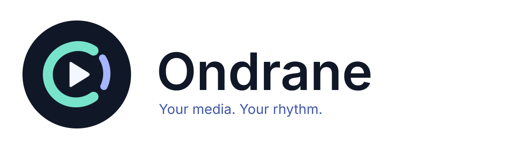
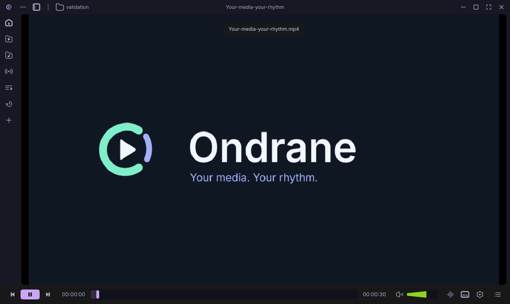
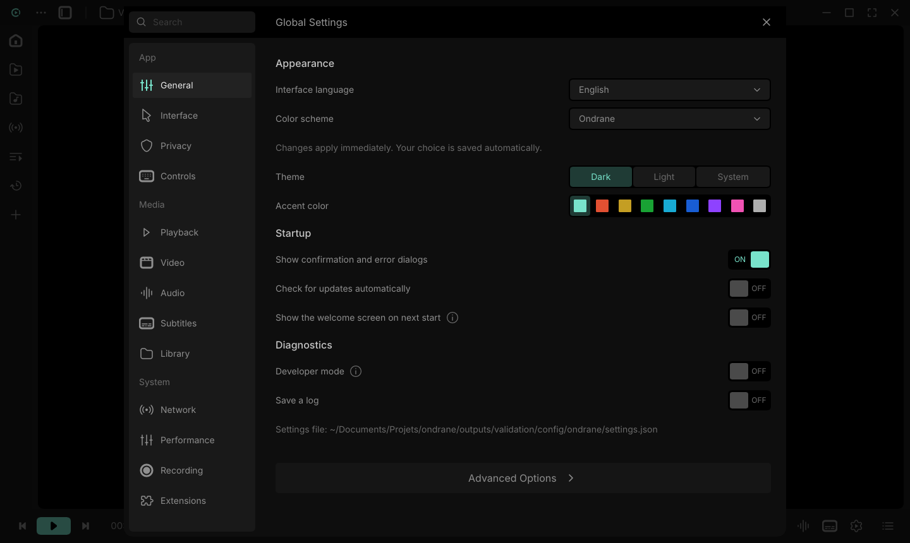
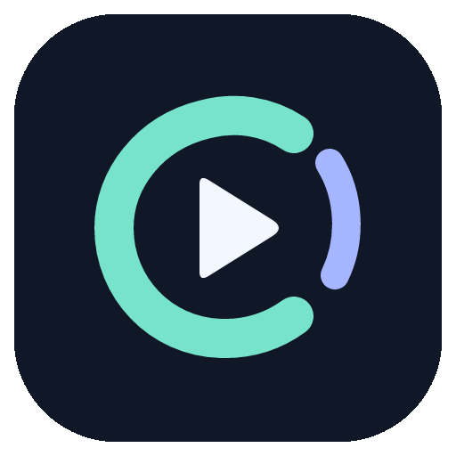

<p align="center">
  <picture>
    <source media="(prefers-color-scheme: dark)" srcset="assets/branding/wordmark.svg">
    
  </picture>
</p>

<p align="center">A native desktop player for videos, music and streams.<br>Written in Rust, built with Slint, powered by libVLC.</p>

<p align="center">
  <a href="https://github.com/Lib-LOCALE/ondrane/actions/workflows/ci.yml"></a>
  <a href="LICENSE"></a>
  <a href="https://github.com/Lib-LOCALE/ondrane/releases"></a>
</p>



**Ondrane is an independent project.** Its interface adapts [Juxtopposed](https://www.figma.com/@juxtopposed)’s [VLC Redesign](https://www.figma.com/community/file/1691465999134370980/vlc-redesign), published under [CC BY 4.0](https://creativecommons.org/licenses/by/4.0/). Ondrane adapts the layouts and UI pictograms with a Rust/Slint implementation, Linux integration, new themes and original branding; see the [design credits and modifications](THIRD_PARTY_NOTICES.md#interface-design). It is not affiliated with or endorsed by [VideoLAN](https://www.videolan.org/videolan/) or [Juxtopposed](https://www.figma.com/@juxtopposed).

## What you can do

- Play local video and audio, playlists and network streams through libVLC.
- Keep a library, queue, favourites and resume history; preview the timeline and adjust subtitle timing.
- Choose **Catppuccin** (Mocha, Macchiato, Frappé or Latte), **Dracula, Nord, Gruvbox, Tokyo Night or Rosé Pine**, or customise Ondrane’s own light/dark theme.
- Use native **Wayland** file-selection and idle-inhibition portals. Share a screen or window through the desktop’s ScreenCast permission dialog and PipeWire.
- Adjust audio, equaliser, playback speed, keyboard shortcuts and the control bar. Use the interface in English or French.

<details>
<summary>Appearance and motion</summary>



The original orbit/play identity was drawn in **VectorCraft** and animated in **EffectCraft**. Editable sources, static SVG, animated SVG, vector Lottie and a GIF preview are included in [assets/branding](assets/branding/BRIEF.md). The animated SVG respects reduced-motion preferences. Desktop icons use the static artwork.



</details>

## Install

Download a preview from [Releases](https://github.com/Lib-LOCALE/ondrane/releases). The **Linux Flatpak** includes its playback engine. **Install VLC 3 separately for native archives, Windows and macOS**; those packages load the engine dynamically.

| Platform | Run |
| --- | --- |
| Linux (recommended) | Install the `.flatpak` bundle, then run `flatpak run io.github.lib_locale.ondrane`. See [Flatpak instructions and sandbox limits](packaging/flatpak/README.md). |
| Linux (native alternative) | Install VLC 3, extract the archive and run `./ondrane`, or build and install the desktop entry below. |
| Windows 10/11 x64 | Install 64-bit VLC 3 and the [Microsoft Visual C++ x64 runtime](https://learn.microsoft.com/en-us/cpp/windows/latest-supported-vc-redist/), then use the per-user installer or portable archive. Ondrane itself installs per-user. |
| macOS (Apple Silicon) | Install VLC 3, then extract and open the unsigned `Ondrane.app` preview. The preview is not notarised. |

For a native build on Debian/Ubuntu-based Linux systems:

```sh
sudo apt install vlc
# Optional: Wayland screen/window capture
sudo apt install gstreamer1.0-tools gstreamer1.0-pipewire \
  gstreamer1.0-plugins-base gstreamer1.0-plugins-good
```

Screen capture also requires a working desktop portal with ScreenCast support and PipeWire. Select the source in the desktop’s own permission dialog. See [Wayland support](docs/WAYLAND.md).

## Build from source

Use a current stable Rust toolchain (the UI toolkit requires Rust 1.92 or newer), a C/C++ toolchain and your platform’s development prerequisites.

```sh
git clone https://github.com/Lib-LOCALE/ondrane.git
cd ondrane
# Debian/Ubuntu build dependencies
sudo apt install build-essential pkg-config libfontconfig1-dev libxkbcommon-dev
cargo build --release --locked
./target/release/ondrane
```

On Linux, `cargo xtask install` installs the executable, desktop entry, notices and icons for the current user. VLC must remain available on the system. For a custom runtime location, set `VLC_LIB_PATH` to the full path of `libvlc.so.5`, `libvlc.dll` or `libvlc.dylib` and make its dependencies/plugins available to the operating system’s loader.

```sh
ondrane path/to/video.mkv
ondrane --fullscreen --sub subtitles.srt video.mkv
ondrane --diag
# Useful when a GPU renderer is unavailable
SLINT_BACKEND=winit-software ondrane
```

See [build and packaging instructions](packaging/BUILD.md) for Windows, macOS and distribution notices.

## Everyday shortcuts

| Action | Shortcut | Action | Shortcut |
| --- | --- | --- | --- |
| Open files | Ctrl+O | Open folder | Ctrl+F |
| Play/pause | Space | Stop | S |
| Fullscreen | F | Leave fullscreen | Esc |
| Previous/next | P / N | Seek | Left / Right |
| Volume | Up / Down | Mute | M |
| Preferences | Ctrl+P | Library/player | Ctrl+L |

Shortcuts are configurable in Settings. Preferences, history and toolbar settings use the platform’s user-configuration directory (`~/.config/ondrane` on Linux). Existing VLC Reborn settings, library history and toolbar files are copied on first load when the corresponding Ondrane files do not exist; the originals are preserved.

## Project status

**0.1 preview.** Linux/Wayland is the primary locally exercised platform. CI builds and tests Linux, Windows and macOS; this does not establish native playback/peripheral parity on every platform.

Embedded video currently decodes into a CPU RGBA buffer. It does not provide zero-copy GPU video or HDR output. Separate-window hardware decoding depends on libVLC, drivers and plugins. Native Wayland file drag-and-drop remains limited by winit 0.30; the optional XWayland mode is available for that workflow. Chromecast, optical media and capture-device behaviour depend on hardware and installed plugins. [Validation scope and limitations](docs/VALIDATION.md) documents what has actually been checked.

## Contributing

See [CONTRIBUTING.md](CONTRIBUTING.md) for checks and desktop integration tests. Report reproducible issues using the GitHub templates. For security issues, use the [security policy](SECURITY.md).

## Credits and licences

- **Application code:** MIT. Original copyright notices, including Nirmal Joseph Ukken’s, are preserved in [LICENSE](LICENSE).
- **Interface design and extracted UI pictograms:** [Juxtopposed](https://www.figma.com/@juxtopposed), [*VLC Redesign*](https://www.figma.com/community/file/1691465999134370980/vlc-redesign), [CC BY 4.0](https://creativecommons.org/licenses/by/4.0/), adapted for Rust/Slint, Linux portals, additional themes and accessibility fixes.
- **Ondrane branding:** original VectorCraft/EffectCraft artwork, MIT; [sources and motion details](assets/branding/BRIEF.md).
- **Slint:** used under its Royalty-free Desktop, Mobile, and Web Applications License 2.0. The application includes `AboutSlint` in its About dialog.
- **Playback:** libVLC by [VideoLAN and contributors](https://www.videolan.org/videolan/), included in the Linux Flatpak and loaded from the user’s VLC installation by native packages. **Font:** Inter, SIL OFL. **Palettes:** their respective upstream licences, preserved in [assets/theme-licenses](assets/theme-licenses).

[Third-party notices](THIRD_PARTY_NOTICES.md) cover the component licences. `cargo xtask licenses` assembles dependency notices, Inter and palette notices, and the MPL-covered `option-ext` source for binary distributions.

<p align="center"><a href="https://slint.dev"></a></p>
