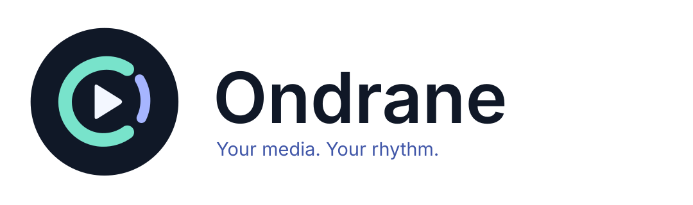
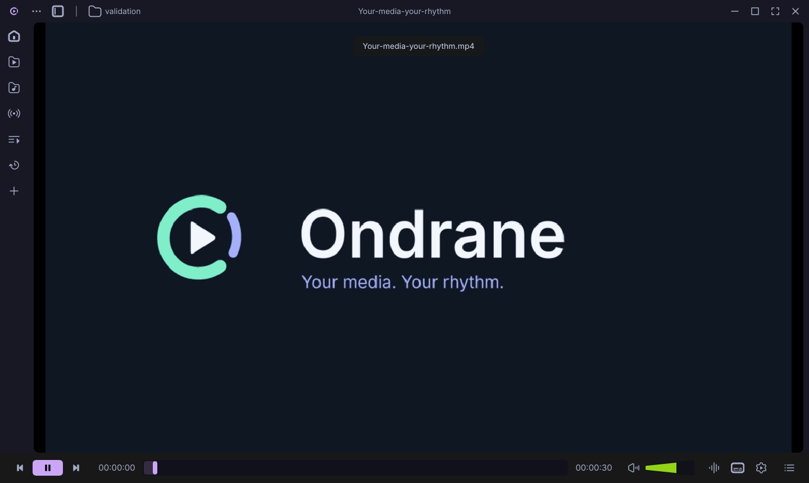
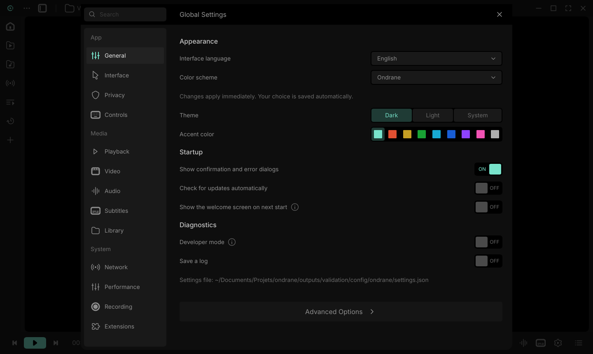
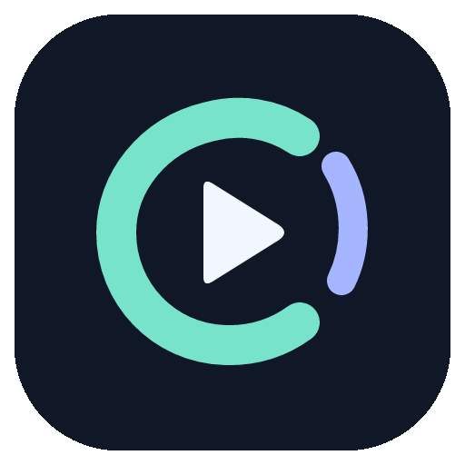

<p align="center">
  <picture>
    <source media="(prefers-color-scheme: dark)" srcset="assets/branding/wordmark.svg">
    
  </picture>
</p>

<h3 align="center">Fast, native cross-platform media player for Windows, Linux & macOS</h3>

<p align="center">
  Written in <strong>Rust</strong> · GPU-accelerated <strong>Slint</strong> interface · Powered by <strong>libVLC 3</strong>
</p>

<p align="center">
  <a href="https://github.com/Lib-LOCALE/ondrane/actions/workflows/ci.yml"></a>
  <a href="https://github.com/Lib-LOCALE/ondrane/releases/latest"></a>
  
  <a href="LICENSE"></a>
</p>

<p align="center">
  
</p>

> **Ondrane** is an independent, pure-Rust desktop media player implementing [Juxtopposed](https://www.figma.com/@juxtopposed)'s [*VLC Redesign*](https://www.figma.com/community/file/1691465999134370980/vlc-redesign) (CC BY 4.0) with a GPU-accelerated Slint interface, zero-bloat native OS integrations across Windows, Linux, and macOS, and pure-Rust engine modules that go well beyond the stock VLC Qt interface.
> It is not affiliated with or endorsed by [VideoLAN](https://www.videolan.org/videolan/) or Juxtopposed.

---

## Why Ondrane vs. stock VLC?

Stock VLC delegates almost everything (UI, dialogs, discovery, skins, preferences, playlist parsing, web interface) to heavyweight C/Qt/Lua layers. Ondrane keeps **libVLC strictly for rock-solid codec/container decoding** and rewrites the entire surrounding player in **memory-safe Rust + Slint**:

| Capability | Stock VLC (Qt) | Ondrane (Rust + Slint) |
| --- | --- | --- |
| **Window startup** | Blocks while scanning plugins | **Non-blocking startup** — window opens immediately while libVLC loads on a worker thread |
| **UI stack** | Qt widgets / legacy skin bitmap engine | **Declarative GPU-rendered Slint UI** with 6 built-in themes (**Catppuccin**, **Dracula**, **Nord**, **Gruvbox**, **Tokyo Night**, **Rosé Pine**) + custom JSON skins |
| **Windows dialogs & registry** | Qt file dialogs / heavy wrappers | **Direct Win32 FFI** (`GetOpenFileNameW`, `GetSaveFileNameW`, `SHBrowseForFolderW`, `RegGetValueW`, `SetDllDirectoryW`, `ShellExecuteW`, `SetThreadExecutionState`) — zero PowerShell, zero flashing console windows |
| **macOS & Linux integration** | Partial Qt abstraction | **Native Wayland XDG Portals** (FileChooser, ScreenCast + PipeWire, Inhibit), StatusNotifier tray, CoreFoundation/caffeinate on macOS |
| **Seekbar preview & posters** | None out of the box | **SHA-1 keyed sprite-sheet cache & background poster worker** with frame-sequence sync |
| **Music waveform** | Flat progress slider | **Pure-Rust acoustic RMS waveform** (direct RIFF/WAVE PCM/float parsing) + smooth deterministic fallback for streams |
| **Playlists** | C module pipeline | **Pure-Rust parser** with BOM handling, `file://` decoding, and auto-detection for **M3U / M3U8 / PLS / XSPF** |
| **Chromecast discovery** | Avahi / libmicrodns external plugins | **Pure-Rust mDNS (`_googlecast._tcp.local`)** LAN scanner + libVLC renderer handoff |
| **Web remote & scrobbling** | Lua HTTP daemon + C module | **Built-in pure-Rust HTTP remote** (HTTP Basic Auth, responsive mobile UI) & **Last.fm / Libre.fm Audioscrobbler v1.2** |
| **Settings UX** | Overwhelming flat tree | **Clean 3-pillar settings** (App · Media · System), instant search, Basic/Advanced toggle & custom toolbar builder |

---

## Install

Download packages and checksums from [**Releases**](https://github.com/Lib-LOCALE/ondrane/releases).

> [!NOTE]
> The **Linux Flatpak** bundles its own `libvlc5`. For **Windows**, **macOS**, and native **Linux archives**, install **VLC 3 (64-bit)** — Ondrane automatically discovers it (including via the Windows Registry, Program Files, Scoop, or `VLC_LIB_PATH`) with no extra configuration.

| Platform | Download | Notes |
| --- | --- | --- |
| **Windows 10 / 11 (x64)** | `Ondrane-Setup-<ver>.exe` or `ondrane-<ver>-windows-x86_64.zip` | Per-user installer (no admin rights required) & portable ZIP. Install **64-bit VLC 3** (`winget install VideoLAN.VLC` or [videolan.org](https://www.videolan.org/vlc/download-windows.html)) and the [VC++ x64 Runtime](https://learn.microsoft.com/en-us/cpp/windows/latest-supported-vc-redist/). |
| **Linux (Flatpak)** | `ondrane-<ver>-x86_64.flatpak` | Self-contained (`flatpak install` then `flatpak run io.github.lib_locale.ondrane`). See [Flatpak guide](packaging/flatpak/README.md). |
| **Linux (Native archive)** | `ondrane-<ver>-linux-x86_64.tar.gz` | Requires system `libvlc5` (`sudo apt install vlc`). Supports native Wayland & X11. |
| **macOS (Apple Silicon)** | `ondrane-<ver>-macos-arm64.tar.gz` | Unsigned `Ondrane.app` bundle. Install VLC 3 in `/Applications/VLC.app`. |

---

## Features & Showcase

- **Unified Library & Player** — Switch seamlessly between Home (*Continue Watching*, *Listen Again*, *Frequently Visited Folders*), Videos, Music, Network Streams, Playlists (`.m3u`, `.m3u8`, `.pls`, `.xspf`), and Recent History.
- **Audio & Video Precision** — 10-band equalizer with presets, replay gain, spatial/stereo widening, pitch shift, hardware decoding toggle, video color adjustments, crop/zoom/aspect ratio, snapshots with instant preview, and lossless/transcoded recording & stream-out.
- **Batch Subtitle Matcher** — Match external `.srt` / `.ass` / `.vtt` subtitle files to whole episode folders in one click.
- **Bilingual UI** — Complete English & French translations bundled directly into the binary.
- **Original Identity** — Vector/motion artwork designed in **VectorCraft** & **EffectCraft** ([brand details](assets/branding/BRIEF.md)).

<details>
<summary>More screenshots & branding motion</summary>



<p align="center">
  
</p>

</details>

---

## Keyboard Shortcuts

| Action | Shortcut | Action | Shortcut |
| --- | --- | --- | --- |
| Open file(s) | `Ctrl+O` | Open folder | `Ctrl+F` |
| Play / Pause | `Space` | Stop | `S` |
| Fullscreen | `F` | Exit fullscreen | `Esc` |
| Previous / Next | `P` / `N` | Seek backward / forward | `Left` / `Right` |
| Volume up / down | `Up` / `Down` | Mute | `M` |
| Preferences | `Ctrl+P` | Toggle Library / Player | `Ctrl+L` |

All shortcuts are rebindable inside **Settings › Controls › Edit Keyboard Shortcuts**.

---

## Architecture (Pure Rust Workspace)

```text
ondrane/
├── ondrane/
│   ├── src/
│   │   ├── engine.rs         # Dynamic libVLC loader, PE bitness check, frame callbacks, equalizer & dialogs
│   │   ├── pickers.rs        # Win32 common DLL dialogs (Open/Save/Browse), XDG portals, macOS osascript
│   │   ├── library.rs        # Folder browser, history, M3U/PLS/XSPF parsers, pure-Rust WAV RMS waveform
│   │   ├── thumbs.rs         # SHA-1 seekbar sprite sheets & background poster extractor
│   │   ├── mdns.rs           # Pure-Rust mDNS (_googlecast._tcp.local) Chromecast discovery
│   │   ├── remote.rs         # Embedded HTTP remote-control server with mobile UI
│   │   ├── scrobbler.rs      # Pure-Rust Last.fm / Audioscrobbler v1.2 client
│   │   ├── system.rs         # Win32 Registry/ExecutionState, tray icon, update checks, notifications
│   │   ├── settings.rs       # 3-pillar (App / Media / System) JSON config & theme palettes
│   │   └── gui/              # Slint state controller, shortcuts, playback loop, capture devices
│   └── ui/                   # Declarative Slint components & Catppuccin/Dracula/Nord/Gruvbox/Tokyo/Rosé tokens
└── xtask/                    # License collector & NSIS Windows installer builder
```

---

## Build from Source

Requires **Rust 1.92+**, a C/C++ toolchain, and platform UI prerequisites:

### Windows (PowerShell)

```powershell
git clone https://github.com/Lib-LOCALE/ondrane.git
cd ondrane
cargo build --release --locked -p ondrane
.\target\release\ondrane.exe --diag
```

### Linux (Debian / Ubuntu)

```sh
git clone https://github.com/Lib-LOCALE/ondrane.git
cd ondrane
sudo apt install build-essential pkg-config libfontconfig1-dev libxkbcommon-dev libxkbcommon-x11-dev vlc
cargo build --release --locked -p ondrane
./target/release/ondrane --diag
```

Useful CLI flags:

```sh
ondrane path/to/video.mkv
ondrane --fullscreen --sub subtitles.srt video.mkv
ondrane --diag                          # Verify libVLC detection, PE/ELF paths, settings & tokens
SLINT_BACKEND=winit-software ondrane    # Software fallback when GPU acceleration is unavailable
```

See [packaging/BUILD.md](packaging/BUILD.md) for Windows NSIS installer generation (`cargo xtask windows-installer`), macOS bundles, and [docs/VALIDATION.md](docs/VALIDATION.md) for CI test coverage and known engine constraints (e.g. embedded video RGBA CPU buffer vs. separate-window hardware decoding).

---

## Credits & Licences

- **Application code:** [MIT License](LICENSE), preserving original copyright notices including [Nirmal Joseph Ukken](https://github.com/nirmaljosephukken).
- **Design system & pictograms:** [Juxtopposed](https://www.figma.com/@juxtopposed), [*VLC Redesign*](https://www.figma.com/community/file/1691465999134370980/vlc-redesign) ([CC BY 4.0](https://creativecommons.org/licenses/by/4.0/)). See [THIRD_PARTY_NOTICES.md](THIRD_PARTY_NOTICES.md).
- **UI framework:** [Slint](https://slint.dev) (Royalty-free Desktop, Mobile, and Web Applications License 2.0).
- **Media engine:** libVLC by [VideoLAN](https://www.videolan.org/videolan/).
- **Typography & palettes:** Inter (SIL OFL) and upstream theme palettes preserved in [assets/theme-licenses](assets/theme-licenses).

<p align="center"><a href="https://slint.dev"></a></p>
